# Kota Palembang 3D — Real Satellite 3D & Interactive Diorama

> **Live Demo:** https://andresudi.github.io/palembang-3d/ *(auto-deployed via GitHub Pages)*

A dual-mode interactive 3D web visualization of **Palembang, South Sumatra, Indonesia**, built with **MapLibre GL JS (`^6.19.0`)**, **Three.js (`^0.187.0`)**, and **Vite (`^8.4.0`)** — requiring **zero paid API keys**.

Switch seamlessly with one click in the top bar between:
1. **Real Satellite 3D Mode (`Satelit 3D`, default)** — Real 1:1 GPS scale locked to the curated Palembang landmark corridor (`maxBounds`) combining **Esri World Imagery** satellite photography, **OpenFreeMap / OpenStreetMap** 3D building extrusions, **AWS Terrarium** 3D terrain elevation, **7 custom true-scale Three.js WebGL 3D hero overlays** (**Ampera Bridge**, **Musi IV Bridge**, **Masjid Agung SMB I**, **Monpera**, **Benteng Kuto Besak**, **Kemaro Island 9-Story Pagoda**, **elevated South Sumatra LRT viaduct**, and **Gelora Sriwijaya Jakabaring floodlights**), **1:1 Diorama-parity live animations** (420 viewport-aware vehicles, 8 LRT trains, 42 *perahu ketek* & speedboats, 6 coal barge convoys, animated Bundaran Air Mancur fountain, waving BKB flag), **Ride-Along / Auto-Tour / Free Drone**, **20-POI Culinary & Tourism Passport + Procedural Web Audio**, **Live Open-Meteo Weather + 3D Rain + Musi Tide Simulation + GIS Distance Measure**, and **Shareable Camera Deep-Links**.
2. **Stylized PBR Diorama Mode (`Diorama`)** — 100% offline/zero-CDN procedural Three.js miniature diorama featuring procedural PBR textures, dynamic `PMREMGenerator` sky IBL reflections, animated river & road traffic, 11 iconic landmarks, and `UnrealBloomPass` lighting.

> A companion engineering & feasibility analysis report (in English) is included at [`ANALISIS_PALEMBANG_3D.md`](./ANALISIS_PALEMBANG_3D.md).

---

## Mode 1: Real Satellite 3D (Esri + OSM 3D + Three.js Overlays)

### Musi River Corridor — Real 1:1 Scale (Day & Night)


### Real-World Landmarks Gallery

| Ampera Bridge & Live LRT Sunset (1:1 GPS Scale) | Masjid Agung SMB I, Monpera & Bundaran Air Mancur (3D Hero Overlays) |
| :---: | :---: |
| 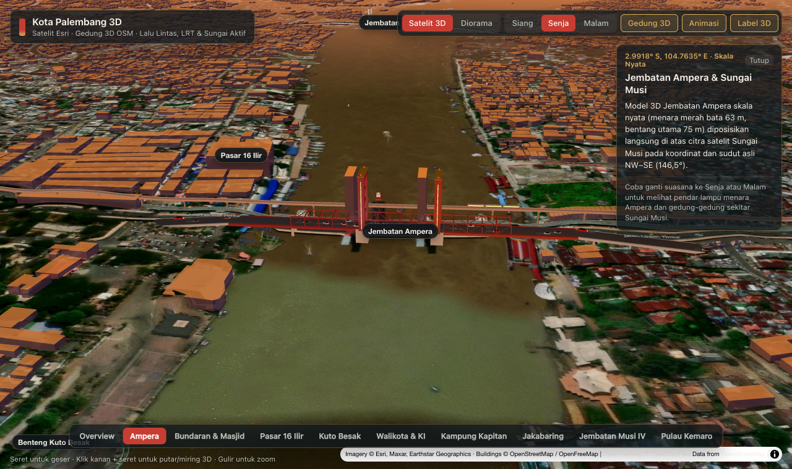 |  |

| Benteng Kuto Besak & Lawang Kuto 3D Overlay | Musi IV Bridge & Musi River Coal Barge |
| :---: | :---: |
| 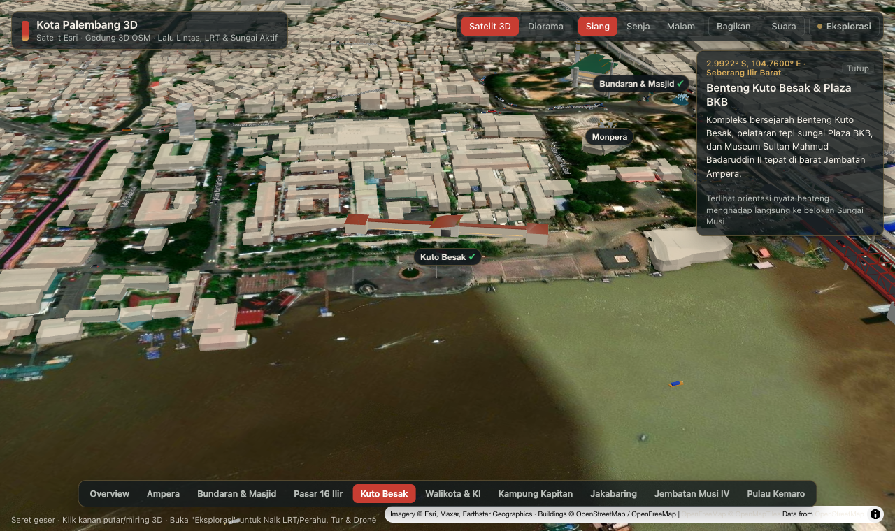 |  |

| Ampera Bridge Day Traffic & Boats | Kemaro Island & 9-Story Pagoda Overlay |
| :---: | :---: |
|  |  |

| Exploration Drawer (Ride-Along, Tour & Drone) | Culinary Explorer, Passport (X/20) & Audio Ambience |
| :---: | :---: |
| 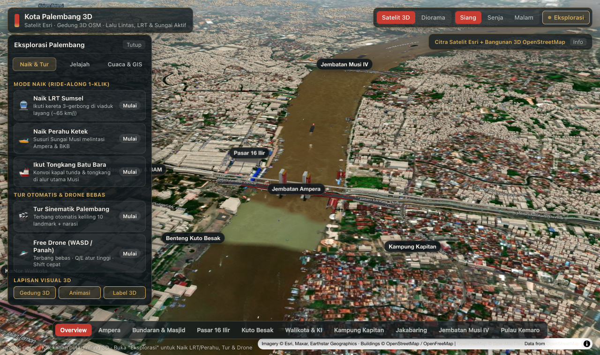 | 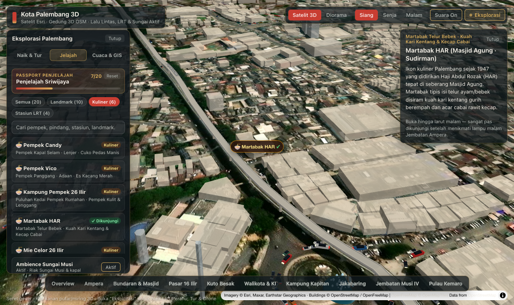 |

| Ride-Along Perahu Ketek (Musi River) | Smart City: Live Weather, 3D Rain, Musi Tide & GIS Measure |
| :---: | :---: |
| 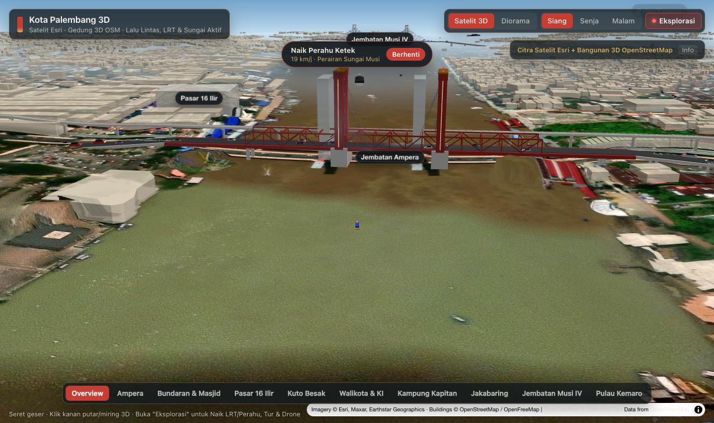 | 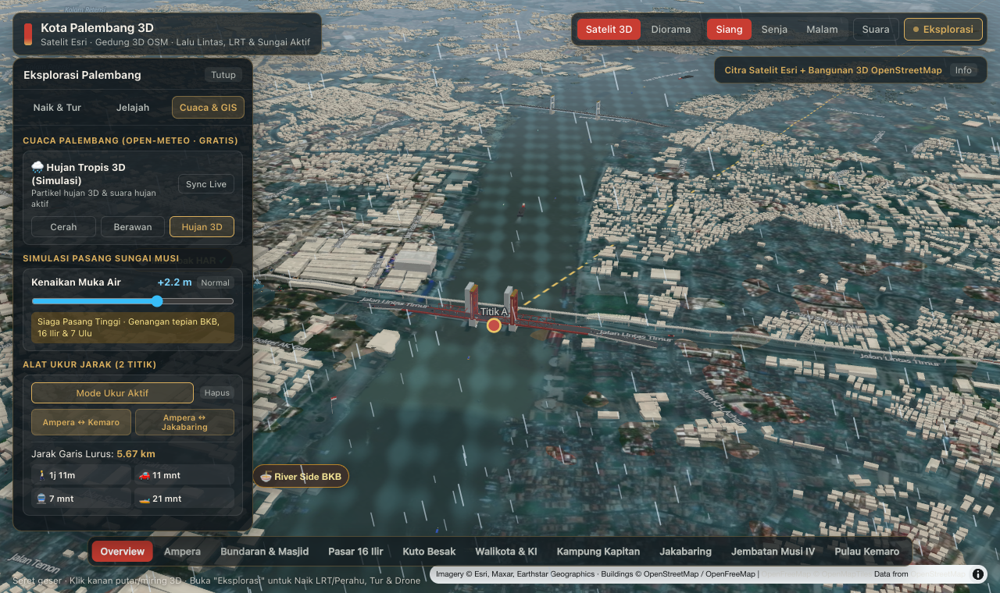 |

| Playable Perahu Ketek & Srivijaya Relics Quest | Night Fireworks over Ampera & Kemaro Lanterns |
| :---: | :---: |
| 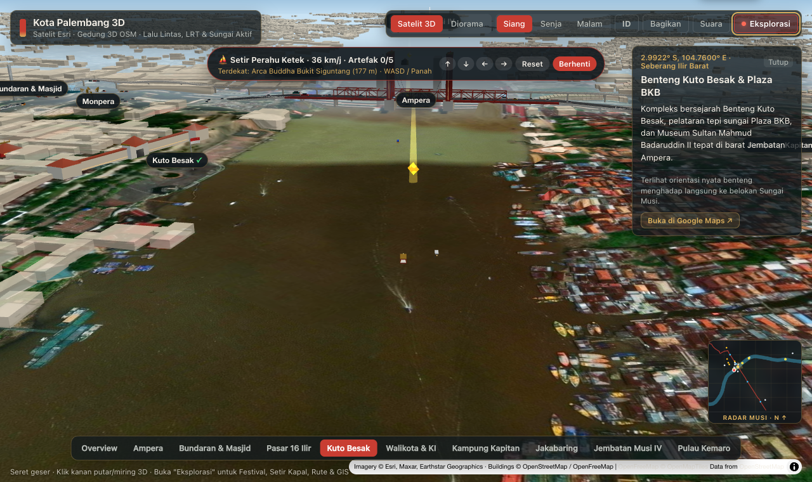 | 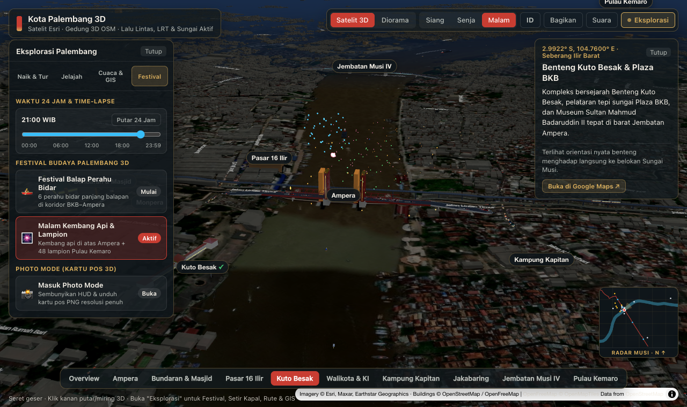 |

| Real Road Route Planner (OSRM) & English Mode | Gedung Ledeng, Rumah Limas & 2D Mini-Map Radar |
| :---: | :---: |
| 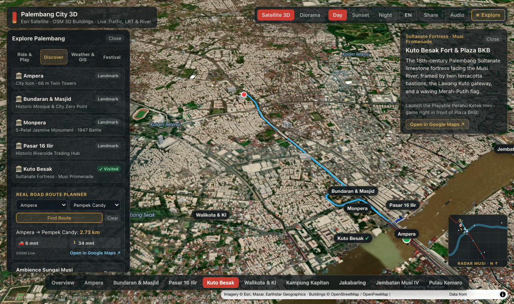 | 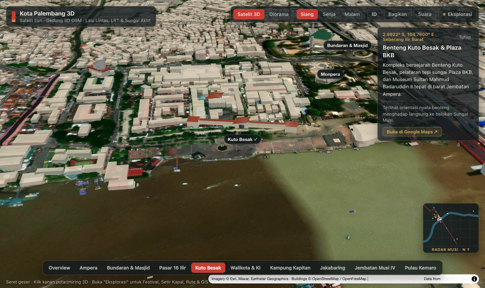 |

| 5-Era Palembang Historical Timeline (Sepia Archival Mode) | Real Wikimedia Landmark Photos & Fullscreen Lightbox |
| :---: | :---: |
| 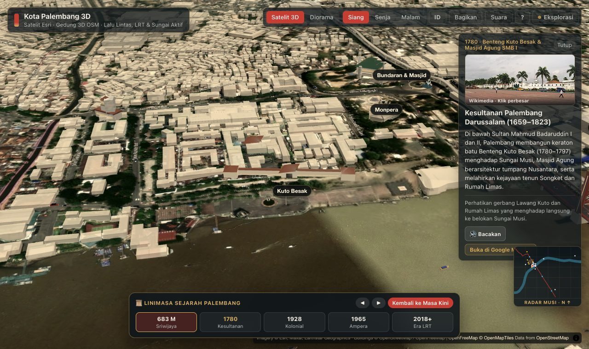 | 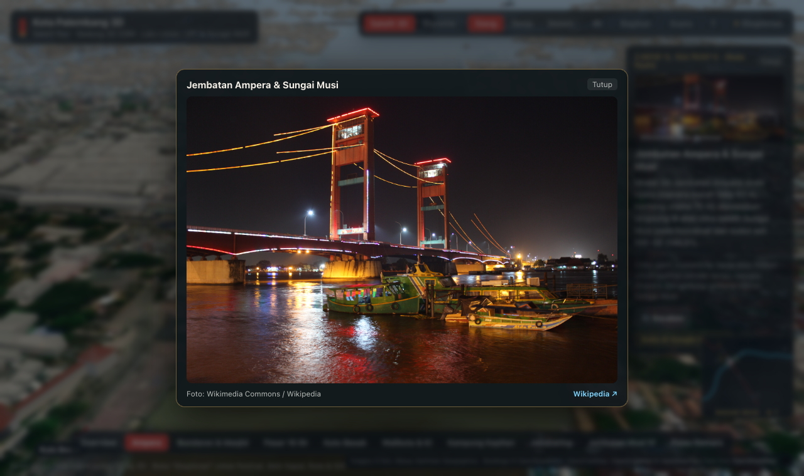 |

---

## Mode 2: Offline Stylized PBR Diorama (Three.js + UnrealBloom)

| Overview — Day | Overview — Night (UnrealBloom) |
| :---: | :---: |
|  |  |

| Ampera Bridge at Sunset | Jakabaring Stadium Night Floodlights |
| :---: | :---: |
|  |  |

| Benteng Kuto Besak & SMB II Museum | Pasar 16 Ilir & Kampung Kapitan |
| :---: | :---: |
|  | 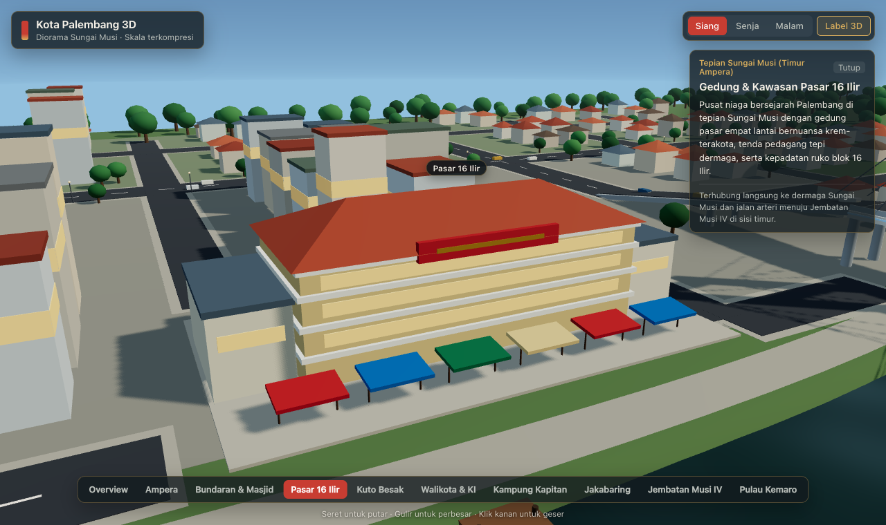 |

---

## Key Features

- **Real-World Geospatial Stack (Zero API Keys)**:
  - **Esri World Imagery** high-resolution aerial satellite basemap
  - **OpenFreeMap / OpenStreetMap** real-time vector tiles & 3D building extrusions (`Gedung 3D` toggle)
  - **AWS Terrarium** 3D elevation terrain + atmospheric sky & horizon fog
  - **Custom MapLibre v6 Three.js 3D WebGL Layers**:
    - **9 True-Scale Hero Overlays**: **Ampera Bridge** (`66m` twin towers with pulsing beacons & ramps), **Musi IV Cable-Stayed Bridge** (`58m` pylons & ramps), **Masjid Agung SMB I** (3-tiered emerald *tumpang* roof + `46m` minaret), **Monpera** (5-petal Melati monument), **Benteng Kuto Besak** (fortress wall, twin bastions & *Lawang Kuto* gate), **Gedung Ledeng (Palembang City Hall 1928 Water Tower)**, **Rumah Limas Traditional Pavilion**, **Kemaro Island 9-Story Pagoda** (`45m`), **elevated South Sumatra LRT viaduct**, and **Gelora Sriwijaya Jakabaring 4 stadium floodlight towers**.
  - **v2.0 Festivals, 24-Hour Time-Lapse & Photo Mode**:
    - Continuous `00:00–23:59` time-of-day slider + auto-play 24h time-lapse, **Traditional Bidar Boat Race** (6 long racing canoes along BKB–Ampera), **Ampera 3D Fireworks & 48 Kemaro Sky Lanterns** (auto-night + procedural firework pops), and **Photo Mode** (zero-HUD view + 1-click PNG postcard export with optional watermark).
  - **Playable Perahu Ketek Mini-Game & Srivijaya Relic Quest**:
    - Steer your own Songket red-and-gold *Perahu Ketek* (`WASD` / Arrows / touch controls) safely inside the Musi River channel and collect **5 rotating golden Srivijaya relics** with live distance compass, radar dots, and completion timer.
  - **Real Road Route Planner, Google Maps, Bilingual (`ID / EN`), 2D Radar & PWA**:
    - Real driving routes via public **OSRM** with automatic local **A\* fallback** on the baked 413 km Palembang OSM road graph, direct **Open in Google Maps** links on every POI & route, full **Indonesian ↔ English** switcher, clickable **2D Mini-Map Radar**, and **PWA** support (`manifest.webmanifest` + `sw.js`).
  - **Visual Heritage & Historical Storytelling (v3.0 — Zero API Key)**:
    - **Real Wikimedia Commons Photos & Lightbox**: Automatically fetches & caches authentic photographs from the Wikipedia/Wikimedia REST API into every Info Card with click-to-enlarge fullscreen Lightbox and graceful offline fallback.
    - **5-Era Palembang Historical Timeline**: Travel across **683 CE Srivijaya → 1780 Sultanate → 1928 Colonial Gedung Ledeng → 1965 Ampera Bridge → 2018+ Modern LRT**, automatically flying to each era's flagship landmark with archival sepia visual tone and a 1-click **Back to Present** reset.
  - **Mobile-Ready UX, Performance & Onboarding (v2.5)**:
    - **Code-Split Architecture**: Thin `4.4 kB` boot shell dynamically loading Satellite 3D vs. Offline Diorama chunks plus independently cached `vendor-maplibre`, `vendor-three`, and `data-palembang-paths` bundles.
    - **Adaptive Graphics Quality (`Tinggi / Hemat`)**: Auto-defaults to **Eco** (`160` vehicles, `18` boats) on mobile screens (`≤ 720px`) and **High** (`420` vehicles, `42` boats) on desktop, switchable anytime inside the drawer.
    - **Mobile Bottom-Sheet Info Card & Compact Top-Bar**: Tapping any landmark or culinary spot on phones opens a crisp bottom sheet with story & Google Maps link above the preset dock.
    - **First-Visit Welcome Guide & `?` Shortcuts Modal**: 1-time onboarding card (auto-skipped on shared deep-links) plus a full `ID / EN` keyboard & touch controls cheat-sheet.
  - **Shareable Camera Deep-Links & Public Hosting**: Click **`Bagikan` / `Share`** in the top bar to copy a URL preserving exact `lng`, `lat`, `zoom`, `pitch`, `bearing`, `lighting`, `lang`, and `weather` state; automatically built & deployed via `.github/workflows/deploy-pages.yml` to https://andresudi.github.io/palembang-3d/.
    - **1:1 Diorama-Parity Live Animations (`Animasi` toggle)**: `420` viewport-aware instanced road vehicles following real OpenStreetMap Palembang streets & bridge decks (Indonesian left-hand drive, dusk/night headlights & taillights, dynamically streaming into whichever district you zoom into), `8` articulated 3-car South Sumatra LRT trains, `42` *perahu ketek* & speedboats with soft aerial V-wakes (including Pulau Kemaro channels), `6` coal barge + tugboat convoys, animated **Bundaran Air Mancur** water fountain, and waving **Merah-Putih** flag at **Benteng Kuto Besak**.
- **Offline Stylized PBR Diorama Mode**:
  - 100% procedural canvas PBR textures (grained asphalt, stone plaza paving, terracotta roof tiles, weathered colonial plaster, mowed stadium turf, multi-story shophouse facades with glowing night windows), dynamic `PMREMGenerator` sky IBL, drifting clouds & night starfield, animated river/road/LRT traffic, and mood-tuned `UnrealBloomPass`.
- **Unified Interactive Controls & Exploration Drawer**:
  - **Slim Top-Bar + Collapsible Left Drawer (`Eksplorasi`)**: Keeps 90%+ of the 3D viewport unobstructed while organizing **Ride-Along**, **Cinematic Auto-Tour**, **Free Drone (`WASD`/Arrows + `Q`/`E` + on-screen controls)**, **Tourism & Culinary Explorer**, and **3D Layer Toggles** (`Gedung 3D`, `Animasi`, `Label 3D`).
  - **Tourism, Culinary & Explorer Passport (`20` POIs)**: Filter color-coded 3D map pins across **10 Landmarks** (including Monpera), **6 Legendary Palembang Culinary Spots** (Pempek Candy, Pempek Vico, Kampung Pempek 26 Ilir, Martabak HAR, Mie Celor 26 Ilir, River Side BKB), and **4 South Sumatra LRT Stations**, complete with live search, persistent `localStorage` **Explorer Passport (`X/20`)** rank badges, and **Procedural Web Audio Ambience** (Musi River water lapping, tropical breeze, and distant riverboat horns — 100% browser-native with top-bar mute toggle).
  - **Smart City Weather & GIS Tools (100% Zero API Key)**:
    - **Live Palembang Weather (Open-Meteo)**: Real-time temperature, humidity, wind, and WMO weather sync + manual `Cerah` / `Berawan` / `Hujan 3D` toggles driving slanted tropical rain particles, overcast sky fog, and procedural Web Audio rain sound.
    - **Musi River Tide / Flood Elevation Simulation (`0.0 m – +3.5 m`)**: Depth-tested 3D shimmering water plane over AWS Terrarium terrain showing riverbank inundation tiers (`Normal` → `Pasang Harian` → `Siaga` → `Banjir Rob Signifikan`).
    - **Two-Point GIS Distance Measure**: Click any two points (or quick presets like `Ampera ↔ Kemaro`) to draw a geodesic line and compute exact Haversine distance (`m`/`km`) plus travel-time estimates by foot, car, South Sumatra LRT, and *perahu ketek*.
  - **1-Click Ride-Along Modes**: Hop aboard a moving 3-car **LRT Sumsel** train (with nearest-station telemetry), ride a **Perahu Ketek** along the Musi River toward Ampera Bridge, or trail a **Coal Barge** convoy.
  - **1-Click Mode Switcher**: `Satelit 3D` ↔ `Diorama` (or direct URL `?mode=satellite` / `?mode=diorama`).
  - **10 Camera Presets**: `Overview`, `Ampera`, `Bundaran & Masjid`, `Pasar 16 Ilir`, `Kuto Besak`, `Walikota & KI`, `Kampung Kapitan`, `Jakabaring`, `Jembatan Musi IV`, and `Pulau Kemaro`.
  - **3 Lighting Moods**: Daylight (`Siang`), Sunset (`Senja`), and Night (`Malam`).

## Prerequisites

- **Node.js `>= 20`** (verified on `v24.22.1` with `npm 11.19.1`).

## Getting Started Locally

1. **Clone & install dependencies:**
   ```bash
   git clone https://github.com/andresudi/palembang-3d.git
   cd palembang-3d
   npm install
   ```

2. **Run development server (hot-reload):**
   ```bash
   npm run dev
   ```
   Open `http://localhost:5173` (defaults to **Real Satellite 3D**; use `?mode=diorama` or the top toggle for the offline Diorama).

3. **Build & preview production bundle:**
   ```bash
   npm run build
   npm run preview
   ```
   Open `http://127.0.0.1:4173` in a WebGL-enabled browser.

4. **Automated Headless WebGL2 Visual QA** (optional):
   ```bash
   npm run verify:satellite   # verifies Real Satellite 3D mode (9 PNG captures)
   npm run verify             # verifies Offline PBR Diorama mode (13 PNG captures)
   ```

## Feasibility & Engineering Report

See [`ANALISIS_PALEMBANG_3D.md`](./ANALISIS_PALEMBANG_3D.md) for an in-depth technical analysis covering 3-tier city-scale feasibility, multi-agent orchestration vs. alternative execution patterns, phase-by-phase effort & token estimates, AI model recommendations, assumption stress-testing, and a risk register.
