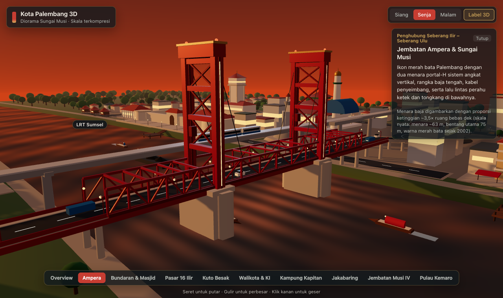
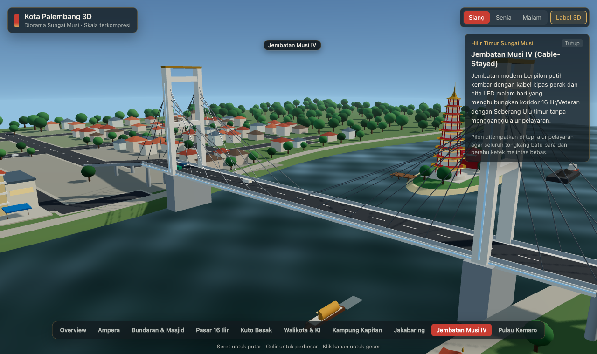

# Kota Palembang 3D — Interactive Stylized Diorama

An interactive procedural 3D visualization of **Palembang, South Sumatra, Indonesia**, built with **Three.js (`^0.187.0`)** and **Vite (`^8.4.0`)**. The entire scene runs locally with zero runtime CDN dependencies, bringing together the **Musi River** corridor, connected urban road networks, high-density `InstancedMesh` neighborhoods, and **11 iconic Palembang landmarks** across Seberang Ilir and Seberang Ulu.

> A companion deep-dive engineering & feasibility report (in Indonesian) is included at [`ANALISIS_PALEMBANG_3D.md`](./ANALISIS_PALEMBANG_3D.md).

## Visual Showcase

### Overview — Musi River Corridor (Day & Night)


### Ampera Bridge at Sunset



### Iconic Landmarks & Districts

| Fountain Roundabout, Great Mosque & Monpera | Pasar 16 Ilir Heritage Market District |
| :---: | :---: |
|  |  |

| Benteng Kuto Besak & SMB II Museum | City Hall (Water Tower) & Kambang Iwak Park |
| :---: | :---: |
|  |  |

| Kampung Kapitan & 7 Ulu Waterfront | Gelora Sriwijaya Jakabaring Stadium (Night) |
| :---: | :---: |
|  |  |

| Musi IV Cable-Stayed Bridge | Kemaro Island & 9-Story Pagoda |
| :---: | :---: |
|  |  |

## Included Landmarks & Features

- **Musi River & Waterfront Embankments**: Custom animated water-ripple shader with sun/dusk/night reflections, Seberang Ilir & Seberang Ulu riverbanks, wooden landing piers, plus live river traffic (*perahu ketek* boats and coal barges with tugboats).
- **Ampera Bridge & Musi IV Bridge**: Iconic brick-red **Ampera Bridge** (twin H-portal towers, steel truss span, counterweights, streetlamps, moving traffic) paired with the modern white cable-stayed **Musi IV Bridge** downstream with night LED strips and full navigation-channel clearance.
- **Seberang Ilir City Core**: Animated **Bundaran Air Mancur** (Fountain Roundabout), **Great Mosque of Sultan Mahmud Badaruddin I** (3-tiered Palembang roof & white minarets), **Monpera Monument**, and the **Pasar 16 Ilir** market building with colorful riverside stalls.
- **Heritage & Civic West District**: **Benteng Kuto Besak (BKB)** fortress & Plaza BKB, colonial **SMB II Museum**, **Palembang City Hall** (*Menara Air / Gedung Ledeng* water tower), and **Kambang Iwak Lake & Park** with a jogging track and gazebo.
- **Seberang Ulu, Kampung Kapitan & Jakabaring Sport City**: Heritage **Kampung Kapitan (7 Ulu)** stilt pavilions and traditional **Rumah Limas** clusters, **Gelora Sriwijaya Jakabaring Stadium** (twin arched canopies & 4 illuminated night floodlight towers), and the elevated **South Sumatra LRT** line running between Ampera Station and Jakabaring Station.
- **Kemaro Island**: Downstream river island featuring the 9-story red-and-gold octagonal **Pagoda**, **Hok Tjing Rio Temple**, tropical foliage, and wooden jetty.
- **Connected Road Grid & Urban Fabric (`InstancedMesh`)**: Zoned commercial/residential paving, major Palembang avenues (*Jl. Jenderal Sudirman, Jl. Kolonel Atmo, Jl. Merdeka, Jl. Jenderal Ahmad Yani, Jl. Gubernur H. Bastari*) with 40 animated vehicles, 81 night-lit shophouses (*ruko*), 241 residential houses, 68 streetlamps, and 978 tropical trees framing the city.
- **Interactive Controls**:
  - Orbit (`left-drag`), zoom (`scroll`), and pan (`right-drag`).
  - **10 Camera Presets**: `Overview`, `Ampera`, `Bundaran & Masjid`, `Pasar 16 Ilir`, `Kuto Besak`, `Walikota & KI`, `Kampung Kapitan`, `Jakabaring`, `Jembatan Musi IV`, and `Pulau Kemaro`.
  - **3 Lighting Modes**: Daylight (`Siang`), Sunset (`Senja`), and Night (`Malam`).
  - **Clickable 3D Labels & Info Card**: Click any floating 3D landmark pin to smoothly fly the camera there, toggle pins with `Label 3D`, or expand/collapse the info panel.

## Prerequisites

- **Node.js `>= 20`** (verified on `v24.22.1` with `npm 11.19.1`).

## Getting Started Locally

1. **Clone & install dependencies:**
   ```bash
   git clone https://github.com/andresudi/palembang-3d.git
   cd palembang-3d
   npm install
   ```

2. **Run development server (hot-reload):**
   ```bash
   npm run dev
   ```
   Open the local URL printed by Vite (default: `http://localhost:5173`).

3. **Build & preview production bundle:**
   ```bash
   npm run build
   npm run preview
   ```
   Open `http://127.0.0.1:4173` in a WebGL-enabled browser (Chrome, Safari, or Firefox).

4. **Run automated headless WebGL2 visual verification** (optional QA):
   ```bash
   npm run verify
   ```
   [`scripts/verify.mjs`](./scripts/verify.mjs) launches `vite preview` on port `4179`, opens headless Chromium (`ANGLE SwiftShader`), verifies `0` console/page errors, exercises all 10 camera presets and lighting modes, checks canvas pixel diversity and mobile HUD bounds (`390×844`), and writes fresh PNG captures into `artifacts/`. *(Requires Playwright and headless Chromium installed locally.)*

## Prototype Scope & Limitations

- **Compressed Diorama Scale**: Relative geographic orientation is preserved (*Seberang Ilir* north `-Z`, *Seberang Ulu* south `+Z`, *Musi River* flowing west `-X` to east `+X`), while longitudinal distances are intentionally compressed (in reality Benteng Kuto Besak lies ~0.6 km west of Ampera and Kemaro Island ~6 km downstream to the east) so all major landmarks remain legible in a single interactive panorama.
- **100% Procedural Stylized Geometry**: Every landmark, bridge, vessel, and urban block is constructed procedurally with Three.js primitives and custom shaders rather than photogrammetry, BIM models, or real-world GIS building extrusions.
- **Offline & Synthetic Traffic**: No external GIS tile streaming (OSM, DEMNAS, or 3D Tiles) or live AIS/LRT telemetry APIs are connected; river vessels, road traffic, and LRT movement are deterministic procedural animations.

## Feasibility & Engineering Report

See [`ANALISIS_PALEMBANG_3D.md`](./ANALISIS_PALEMBANG_3D.md) (written in Indonesian) for an in-depth technical analysis covering 3-tier city-scale feasibility (Stylized vs. GIS OSM+DEMNAS vs. Digital Twin), multi-agent orchestration vs. alternative execution patterns, phase-by-phase effort & token estimates, AI model recommendations, assumption stress-testing, and a risk register.
