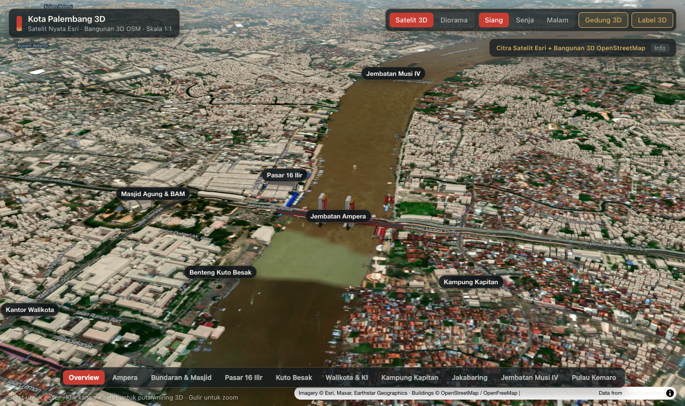
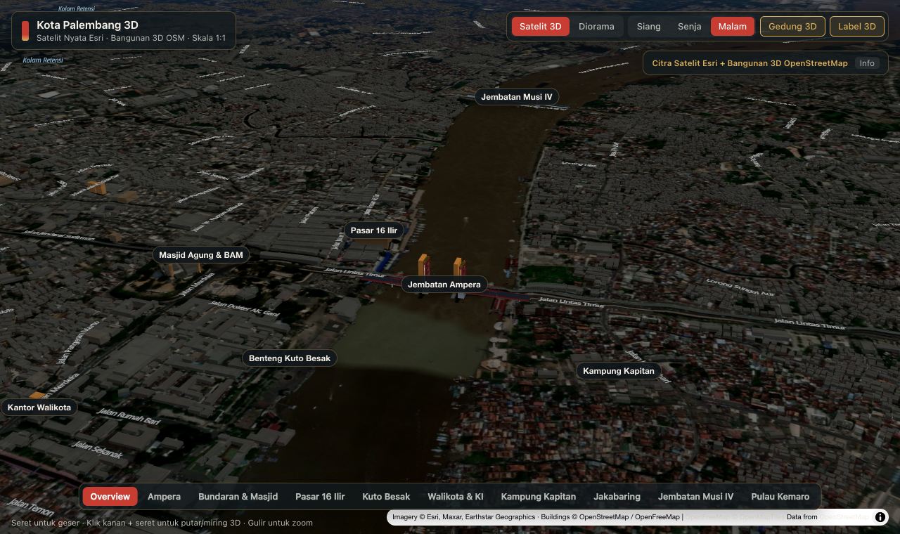
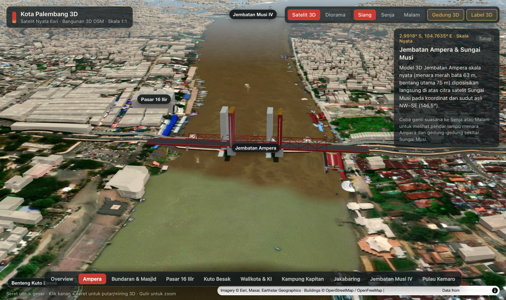
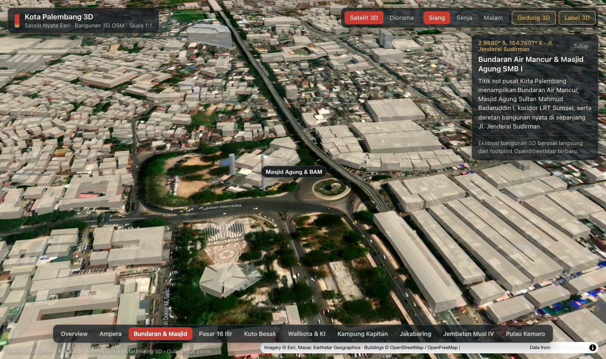
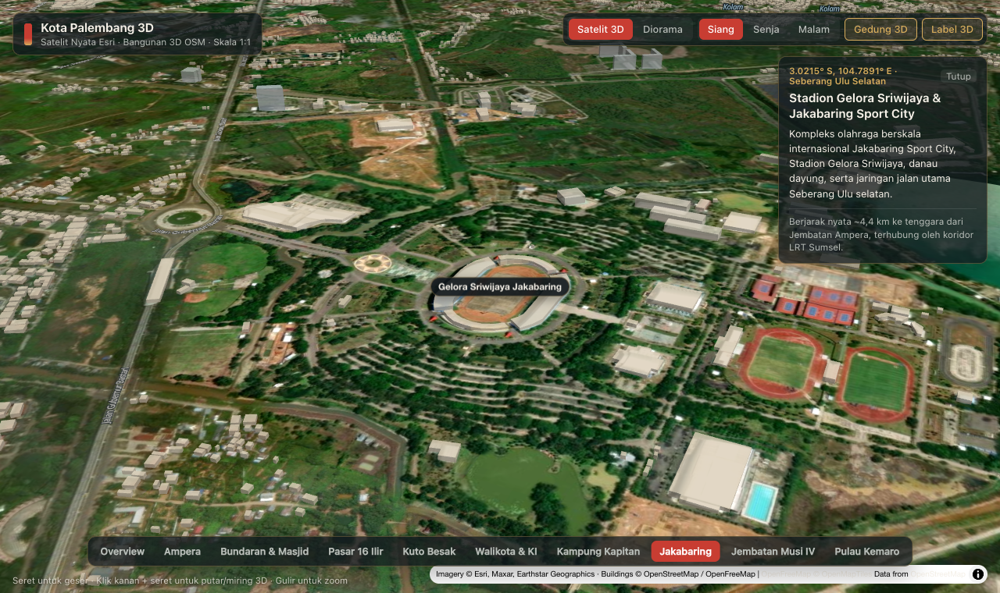
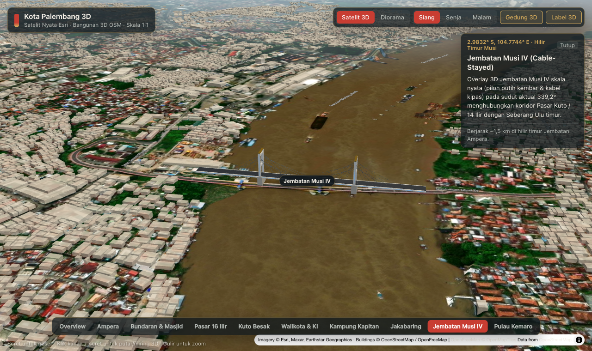
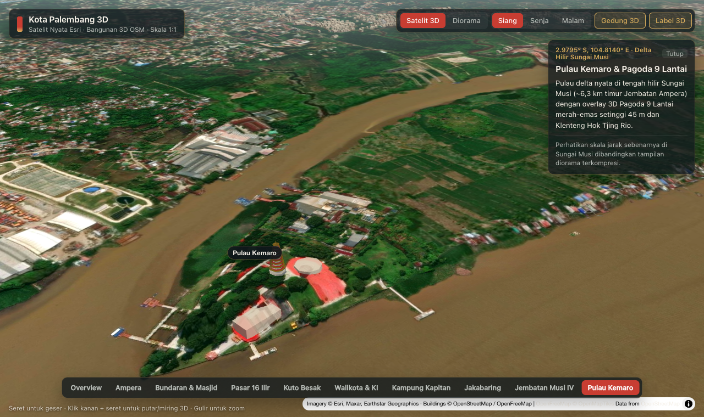
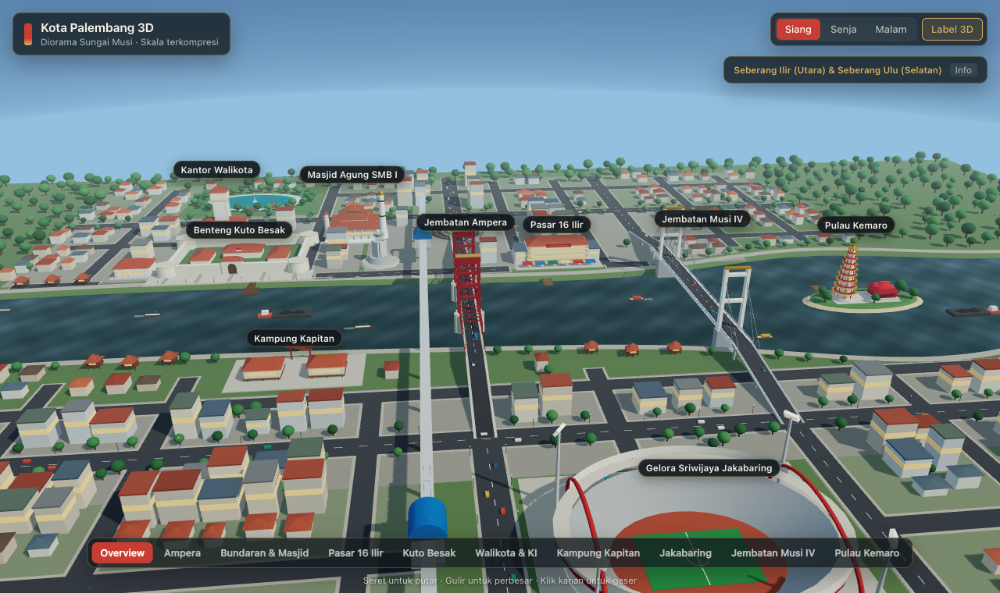
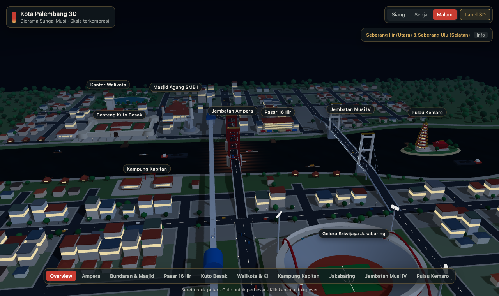

# Kota Palembang 3D — Real Satellite 3D & Interactive Diorama

A dual-mode interactive 3D web visualization of **Palembang, South Sumatra, Indonesia**, built with **MapLibre GL JS (`^6.19.0`)**, **Three.js (`^0.187.0`)**, and **Vite (`^8.4.0`)** — requiring **zero paid API keys**.

Switch seamlessly with one click in the top bar between:
1. **Real Satellite 3D Mode (`Satelit 3D`, default)** — Real 1:1 GPS scale combining **Esri World Imagery** satellite photography, **OpenFreeMap / OpenStreetMap** 3D building extrusions, **AWS Terrarium** 3D terrain elevation, and custom true-scale **Three.js WebGL 3D overlays** for **Ampera Bridge**, **Musi IV Bridge**, and **Kemaro Island 9-Story Pagoda**.
2. **Stylized PBR Diorama Mode (`Diorama`)** — 100% offline/zero-CDN procedural Three.js miniature diorama featuring procedural PBR textures, dynamic `PMREMGenerator` sky IBL reflections, animated river & road traffic, 11 iconic landmarks, and `UnrealBloomPass` lighting.

> A companion engineering & feasibility analysis report (in Indonesian) is included at [`ANALISIS_PALEMBANG_3D.md`](./ANALISIS_PALEMBANG_3D.md).

---

## Mode 1: Real Satellite 3D (Esri + OSM 3D + Three.js Overlays)

### Musi River Corridor — Real 1:1 Scale (Day & Night)





### Real-World Landmarks Gallery

| Ampera Bridge 3D Overlay (1:1 GPS Scale) | Fountain Roundabout, Great Mosque & Monpera |
| :---: | :---: |
|  |  |

| Gelora Sriwijaya Jakabaring Sport City | Musi IV Cable-Stayed Bridge 3D Overlay |
| :---: | :---: |
|  |  |

| Kemaro Island & 9-Story Pagoda Overlay |
| :---: |
|  |

---

## Mode 2: Offline Stylized PBR Diorama (Three.js + UnrealBloom)

| Overview — Day | Overview — Night (UnrealBloom) |
| :---: | :---: |
|  |  |

| Ampera Bridge at Sunset | Jakabaring Stadium Night Floodlights |
| :---: | :---: |
|  |  |

| Benteng Kuto Besak & SMB II Museum | Pasar 16 Ilir & Kampung Kapitan |
| :---: | :---: |
|  |  |

---

## Key Features

- **Real-World Geospatial Stack (Zero API Keys)**:
  - **Esri World Imagery** high-resolution aerial satellite basemap
  - **OpenFreeMap / OpenStreetMap** real-time vector tiles & 3D building extrusions (`Gedung 3D` toggle)
  - **AWS Terrarium** 3D elevation terrain + atmospheric sky & horizon fog
  - **Custom MapLibre v6 Three.js 3D WebGL Layer** anchoring true-scale Ampera Bridge (`66m` twin towers), Musi IV Cable-Stayed Bridge (`58m` pylons), and Kemaro Island 9-Story Pagoda (`45m`) at exact real-world WGS84 coordinates & compass bearings
- **Offline Stylized PBR Diorama Mode**:
  - 100% procedural canvas PBR textures (grained asphalt, stone plaza paving, terracotta roof tiles, weathered colonial plaster, mowed stadium turf, multi-story shophouse facades with glowing night windows), dynamic `PMREMGenerator` sky IBL, drifting clouds & night starfield, animated river/road/LRT traffic, and mood-tuned `UnrealBloomPass`.
- **Unified Interactive Controls**:
  - **1-Click Mode Switcher**: `Satelit 3D` ↔ `Diorama` (or direct URL `?mode=satellite` / `?mode=diorama`).
  - **10 Camera Presets**: `Overview`, `Ampera`, `Bundaran & Masjid`, `Pasar 16 Ilir`, `Kuto Besak`, `Walikota & KI`, `Kampung Kapitan`, `Jakabaring`, `Jembatan Musi IV`, and `Pulau Kemaro`.
  - **3 Lighting Moods**: Daylight (`Siang`), Sunset (`Senja`), and Night (`Malam`).
  - **Clickable Landmark Pins & Info Panel**: Toggle floating pins (`Label 3D`) or OSM 3D extrusions (`Gedung 3D`).

## Prerequisites

- **Node.js `>= 20`** (verified on `v24.22.1` with `npm 11.19.1`).

## Getting Started Locally

1. **Clone & install dependencies:**
   ```bash
   git clone https://github.com/andresudi/palembang-3d.git
   cd palembang-3d
   npm install
   ```

2. **Run development server (hot-reload):**
   ```bash
   npm run dev
   ```
   Open `http://localhost:5173` (defaults to **Real Satellite 3D**; use `?mode=diorama` or the top toggle for the offline Diorama).

3. **Build & preview production bundle:**
   ```bash
   npm run build
   npm run preview
   ```
   Open `http://127.0.0.1:4173` in a WebGL-enabled browser.

4. **Automated Headless WebGL2 Visual QA** (optional):
   ```bash
   npm run verify:satellite   # verifies Real Satellite 3D mode (9 PNG captures)
   npm run verify             # verifies Offline PBR Diorama mode (13 PNG captures)
   ```

## Feasibility & Engineering Report

See [`ANALISIS_PALEMBANG_3D.md`](./ANALISIS_PALEMBANG_3D.md) (written in Indonesian) for an in-depth technical analysis covering 3-tier city-scale feasibility, multi-agent orchestration vs. alternative execution patterns, phase-by-phase effort & token estimates, AI model recommendations, assumption stress-testing, and a risk register.
