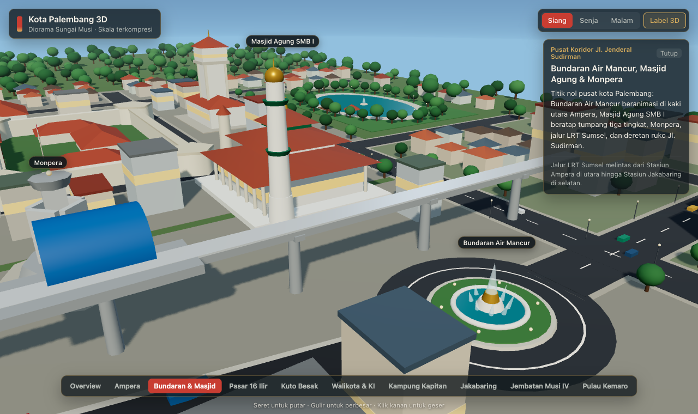
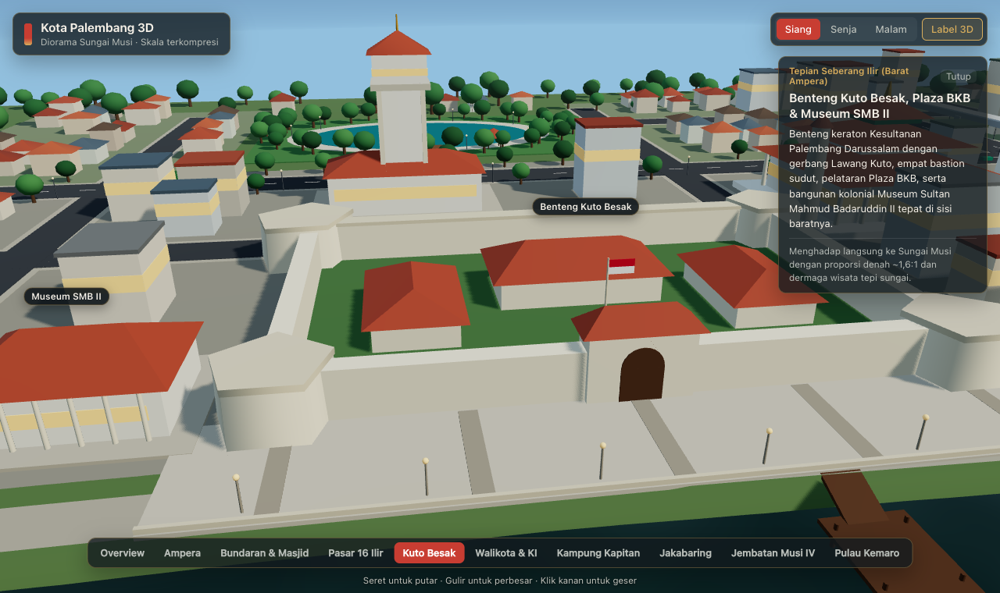
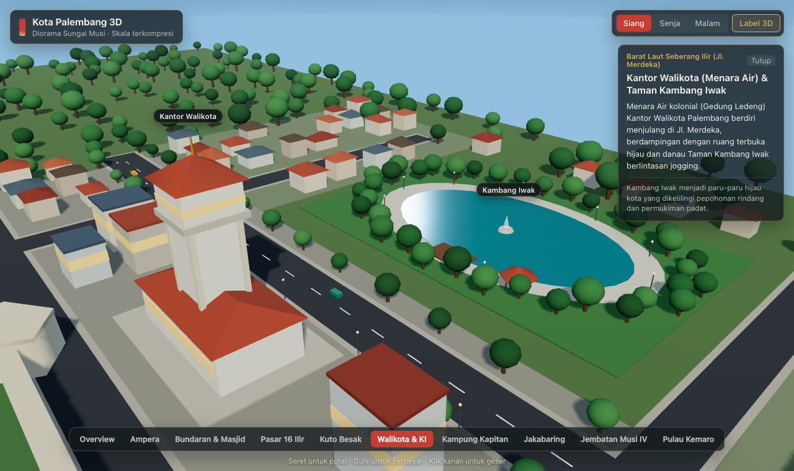
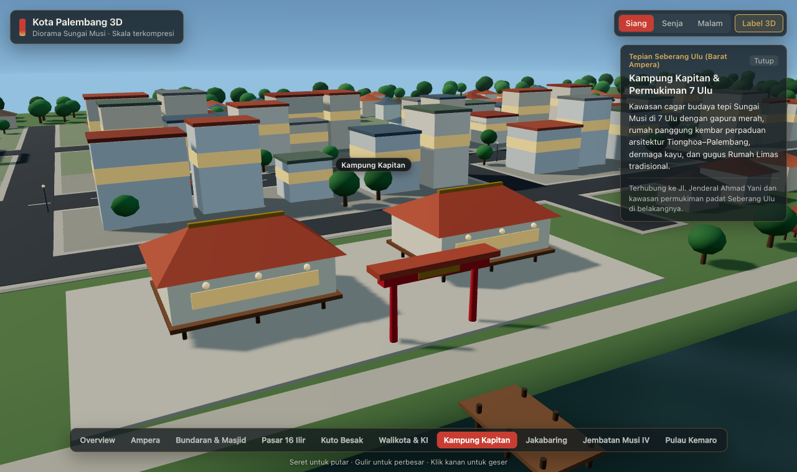
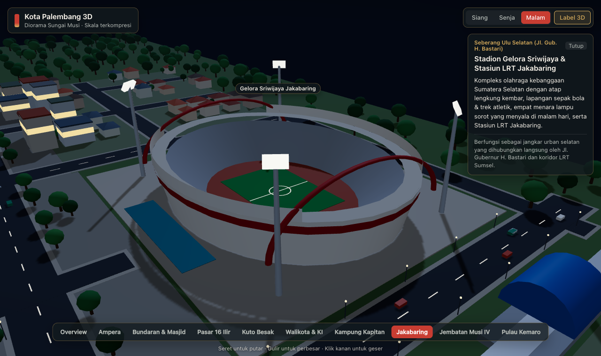
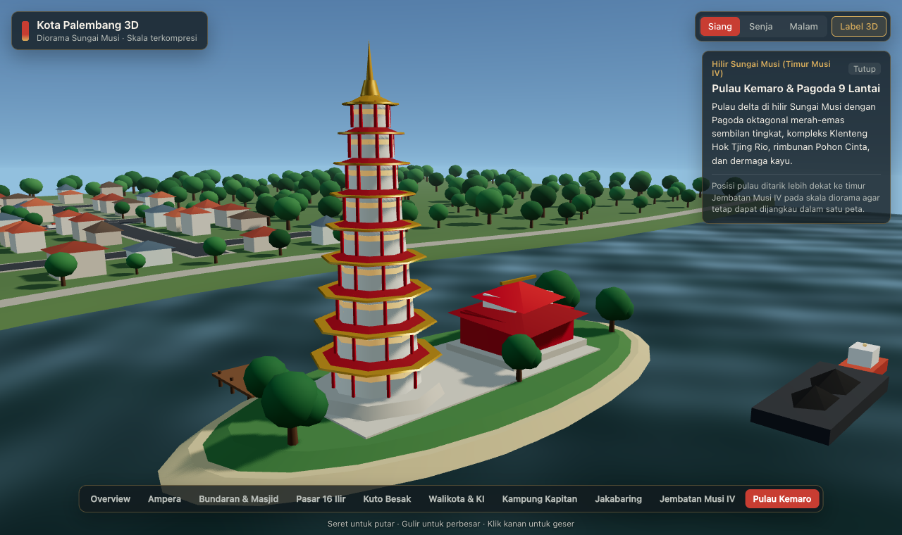

# Kota Palembang 3D — Visualisasi Diorama Interaktif

Visualisasi 3D interaktif Kota Palembang berbasis **Three.js (`^0.187.0`)** dan **Vite (`^8.4.0`)** yang berjalan sepenuhnya secara lokal (100% prosedural, tanpa ketergantungan CDN saat runtime). Adegan menyajikan koridor Sungai Musi bersama jaringan jalan arteri, kepadatan kota berbasis `InstancedMesh`, serta 11 tengara ikonik Seberang Ilir & Seberang Ulu dalam satu diorama interaktif, dilengkapi laporan analisis kritis di [`ANALISIS_PALEMBANG_3D.md`](./ANALISIS_PALEMBANG_3D.md).

## Pratinjau Visual

### Overview — Koridor Sungai Musi (Siang & Malam)


### Jembatan Ampera saat Senja


### Galeri Kawasan & Tengara Ikonik

| Bundaran Air Mancur, Masjid Agung & Monpera | Gedung & Kawasan Pasar 16 Ilir |
| :---: | :---: |
|  |  |

| Benteng Kuto Besak & Museum SMB II | Kantor Walikota (Menara Air) & Kambang Iwak |
| :---: | :---: |
|  |  |

| Kampung Kapitan & 7 Ulu | Stadion Gelora Sriwijaya Jakabaring (Malam) |
| :---: | :---: |
|  |  |

| Jembatan Musi IV (Cable-Stayed) | Pulau Kemaro & Pagoda 9 Lantai |
| :---: | :---: |
|  |  |

## Tengara & Fitur yang Disertakan

- **Sungai Musi & Tepian Seberang Ilir / Seberang Ulu**: Permukaan air dengan shader riak animasi dan pantulan cahaya, turap penahan tepian, dermaga, serta lalu lintas *perahu ketek* dan tongkang batu bara.
- **Jembatan Ampera & Jembatan Musi IV**: Jembatan Ampera merah bata dengan menara portal-H & kendaraan melintas, dilengkapi **Jembatan Musi IV** bergaya *cable-stayed* berpilon putih kembar dan pita LED malam di hilir timur (bebas alur pelayaran).
- **Pusat Kota Seberang Ilir**: **Bundaran Air Mancur Masjid Agung** (air mancur animasi), **Masjid Agung SMB I**, **Monpera**, serta **Gedung & Kawasan Pasar 16 Ilir** lengkap dengan tenda pedagang tepi sungai.
- **Benteng Kuto Besak, Museum SMB II, Kantor Walikota & Kambang Iwak**: Benteng Kuto Besak + Plaza BKB, bangunan kolonial **Museum SMB II**, **Menara Air / Gedung Ledeng Kantor Walikota**, serta **Taman & Danau Kambang Iwak** berlintasan jogging dan pepohonan rimbun.
- **Seberang Ulu, Kampung Kapitan & Jakabaring Sport City**: Kawasan heritage **Kampung Kapitan (7 Ulu)** + gugus *Rumah Limas*, **Stadion Gelora Sriwijaya Jakabaring** (atap lengkung kembar & 4 menara lampu sorot malam), serta jalur **LRT Sumsel** dari Stasiun Ampera hingga Stasiun Jakabaring.
- **Pulau Kemaro**: Pulau hilir di timur Jembatan Musi IV dengan Pagoda oktagonal sembilan lantai merah-emas, Klenteng Hok Tjing Rio, pepohonan tropis, dan dermaga kayu.
- **Jaringan Jalan & Kepadatan Kota (`InstancedMesh`)**: Zoning permukaan kota (komersial/permukiman/taman), jaringan jalan arteri & kolektor (Jl. Sudirman, Jl. Kolonel Atmo, Jl. Merdeka, Jl. A. Yani, Jl. Gub. H. Bastari) dengan 40 kendaraan jalan animasi, 81 ruko berjendela menyala malam, 241 rumah permukiman padat, 68 lampu jalan, dan 978 pohon tropis membingkai kota.
- **Kontrol Eksplorasi Interaktif**:
  - Orbit (`seret klik kiri`), zoom (`gulir`), dan pan (`seret klik kanan`).
  - **10 Preset Kamera**: `Overview`, `Ampera`, `Bundaran & Masjid`, `Pasar 16 Ilir`, `Kuto Besak`, `Walikota & KI`, `Kampung Kapitan`, `Jakabaring`, `Jembatan Musi IV`, dan `Pulau Kemaro`.
  - **3 Mode Pencahayaan**: `Siang`, `Senja`, dan `Malam`.
  - **Label 3D Interaktif & Kartu Info**: Pin tengara yang bisa diklik langsung untuk menerbangkan kamera, tombol `Label 3D`, serta kartu informasi yang dapat dilipat.

## Prasyarat

- **Node.js `>= 20`** (terverifikasi pada `v24.22.1` dengan `npm 11.19.1`).

## Cara Menjalankan Secara Lokal

1. **Clone & instalasi dependensi:**
   ```bash
   git clone https://github.com/andresudi/palembang-3d.git
   cd palembang-3d
   npm install
   ```

2. **Mode pengembangan (hot-reload):**
   ```bash
   npm run dev
   ```
   Buka URL lokal yang ditampilkan Vite di terminal (umumnya `http://localhost:5173`).

3. **Build produksi & jalankan preview lokal:**
   ```bash
   npm run build
   npm run preview
   ```
   Lalu buka `http://127.0.0.1:4173` di peramban (Chrome/Safari/Firefox dengan WebGL aktif).

4. **Verifikasi render headless WebGL2 & tangkapan layar otomatis** (opsional untuk QA):
   ```bash
   npm run verify
   ```
   Skrip [`scripts/verify.mjs`](./scripts/verify.mjs) menjalankan `vite preview` di port `4179`, membuka Chromium headless (`ANGLE SwiftShader`), memeriksa `0` console/page error, menguji seluruh preset kamera dan mode pencahayaan, mengecek keragaman piksel kanvas, memverifikasi batas tata letak HUD pada viewport mobile (`390×844`), serta menyimpan tangkapan layar ke folder `artifacts/`. (Memerlukan Playwright + binary Chromium headless terpasang lokal.)

## Batasan Prototipe

- **Skala Diorama Terkompresi**: Orientasi geografis relatif dijaga (*Seberang Ilir* di utara `-Z`, *Seberang Ulu* di selatan `+Z`, *Sungai Musi* mengalir barat `-X` ke timur `+X`), tetapi jarak memanjang dikompresi secara sengaja (di dunia nyata Benteng Kuto Besak berjarak ~0,5–0,7 km di barat Ampera sedangkan Pulau Kemaro ~6 km di timur hilir) agar seluruh tengara ikonik tetap mudah dieksplorasi dalam satu layar.
- **Geometri Prosedural Stylized**: Seluruh bangunan, jembatan, kapal, dan medan dibangun secara prosedural dengan primitif Three.js; bukan hasil fotogrametri, BIM, maupun ekstrusi data GIS nyata.
- **Tidak Ada Streaming GIS / Data Real-Time**: Belum terhubung ke DEMNAS, OpenStreetMap, Google 3D Tiles, maupun telemetri lalu lintas sungai/LRT langsung.

## Laporan Analisis Kritis

Lihat [`ANALISIS_PALEMBANG_3D.md`](./ANALISIS_PALEMBANG_3D.md) untuk kajian mendalam berbahasa Indonesia mengenai kelayakan implementasi skala kota, perbandingan pola eksekusi (multi-agent orchestrator vs alternatif), estimasi waktu & penggunaan token, rekomendasi model AI per fase, serta uji stres asumsi dan risiko.
